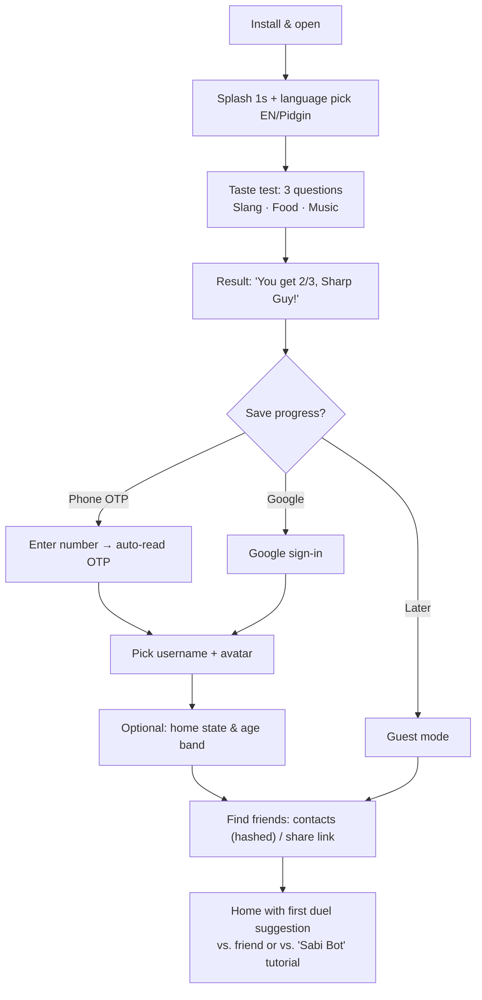
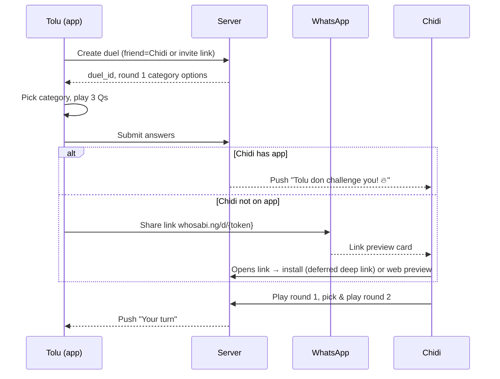
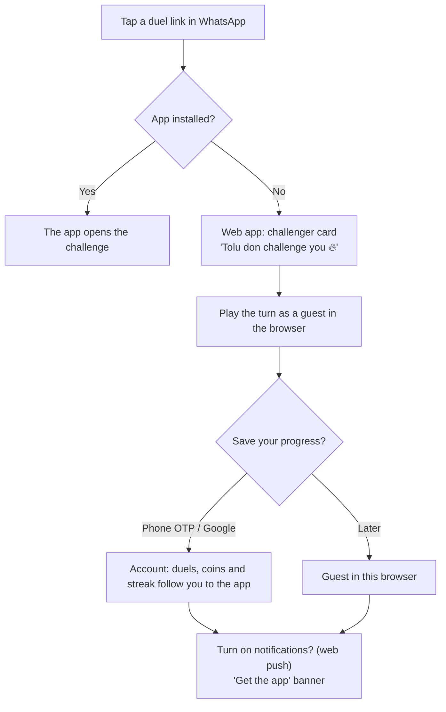

# 05 · UX, User Flows & Screen Specs

**Version:** 1.1 · **Date:** 15 Oct 2026 · *1.1 adds the web app (§1, §2.6, §3.5) and the admin console (§8)*
**Design principles:** thumb-first (one hand on a crowded bus) · big tap targets (≥ 48 dp) · 2 taps to play · readable in bright sun · data-light by default

---

## 1. Information architecture

```
App
├── Home (tab)
│   ├── "Your turn" duels (cards)
│   ├── Daily Sabi Challenge banner
│   ├── Quick actions: [Challenge friend] [Party Room] [Random opponent]
│   └── Waiting on them (duels)
├── Play (tab) → Mode picker: Duel · Party · Daily · Packs (practice)
├── Leagues (tab, v1.1) → My groups · State board · Campus (v2)
├── Shop (tab) → Coins/Gems · Cosmetics · Sabi Pass
└── Profile (tab)
    ├── Stats (by category), badges, rating tier
    ├── Friends · Invite
    └── Settings → Data Saver · Language · Notifications · Family mode · Privacy · Delete account
```

**Web app** (`whosabi.ng`): the same tree as the app. On phones it looks and works like the app; from 1024 px wide, the tab bar becomes a side navigation (§3.5).

**Web party client** (`whosabi.ng/r/{CODE}`): Nickname (or your own account, if you're signed in on the web) → Lobby → Game → Results → "Keep playing in your browser" or "Get the app".

**Admin console** (`admin.whosabi.ng`, staff only): see §8 and doc 18 §4.

---

## 2. Key flows

### 2.1 First-time user (FTUE)

- **Age gate:** at username creation the user picks an age band: Under 13 (blocked, with a friendly message), 13–17, or 18+. 13–17 users get a restricted profile (see compliance doc).
- **Permission asks** are made only when needed: contacts when the user taps "Find friends", notifications after the first duel is sent ("Make we tell you when e reach your turn?").

### 2.2 Challenge a friend (duel)


### 2.3 Party Room
1. Host taps **Party Room** and picks packs (chips), number of questions and timer, then taps **Create**.
2. The lobby shows the room code (big), a **Share to WhatsApp** button, a QR code, and the player list with avatars.
3. Guests join through the app (enter code) or the web link (nickname only).
4. The host taps **Start** (minimum 2 players). Countdown 3-2-1.
5. Per question: question (5 s read time where the options are hidden for long questions) → options → reveal with the % who picked each → mini leaderboard (3 s).
6. The final question is announced as the "Wahala Round ×2".
7. Podium screen with confetti, then **Share podium card** and **Play again** (same room).

### 2.4 Daily Sabi Challenge
Home banner "Daily #142 dey wait 🔥 Streak 12" → 7 questions (no lifelines) → result grid + percentile + state rank → **Share** (WhatsApp Status, X, copy) → see answers & facts → "Challenge a friend on today's toughest category".

### 2.5 Report a question
Long-press the question (or ⋯ on the review screen) → reason chips → optional note → "Thank you! We go check am." (+5 coins once a day for reports that are confirmed later).

### 2.6 Play from a link in the browser (no app)

- The age gate and username step are the same as in the app (§2.1).
- On the first visit, a cookie and consent banner appears before any storage beyond what is strictly necessary.
- `/daily/{n}` links open today's Daily the same way.

---

## 3. Screen specs (wireframe descriptions)

### 3.1 Question screen (most important screen)
```
┌───────────────────────────────┐
│ ⟵   Round 2/3 · Nollywood 🎬  │  top bar: category colour
│ ●●○   You 640  –  Chidi 520   │  progress dots + live score
├───────────────────────────────┤
│        [ image 16:9 ]          │  optional, lazy-loaded, blurhash placeholder
│                               │
│ Who directed The Wedding      │  18–22 sp, max 3 lines
│ Party (2016)?                 │
├───────────────────────────────┤
│ ███████████████░░░░  11s       │  timer bar (colour-shifts at 5s), haptic tick at 3s
├───────────────────────────────┤
│ [ A  Kemi Adetiba          ]  │  option buttons: full width, ≥ 56 dp tall
│ [ B  Niyi Akinmolayan      ]  │
│ [ C  Kunle Afolayan        ]  │
│ [ D  Funke Akindele        ]  │
├───────────────────────────────┤
│  ✂️ 50/50   📊 Ask Naija   ⏭️   │  lifeline row (greyed when not allowed)
└───────────────────────────────┘
```
- **Feedback:** correct = green with a ✓ icon and a short "Ehen!" sound; wrong = red with ✗ and the correct answer highlighted. Icons always accompany colour (colour-blind safe).
- No back button during a question. Leaving counts as a timeout, with a confirm dialog.

### 3.2 Duel result
- Big outcome text ("You win! 👑" / "Chidi win this one 😤"), score comparison by round, rating change (+14), coins earned.
- Buttons: **Rematch** (primary), **Share**, **Review answers**.

### 3.3 Share card (generated on device, 1080×1920 for Status, 1200×630 for link preview)
- Brand header, both avatars, final score, a funny caption ("Tolu don school Chidi for Nollywood 🎓"), QR or link, and the category emoji.
- Generated on device with react-native-view-shot (no upload needed), so it uses no data.

### 3.4 Home
- **Your turn** cards come first, sorted by expiry. Each card has the avatar, score, time left and a **Play** button.
- The Daily banner is pinned until it's done.
- **Empty state:** "No duel yet? Challenge your guy 👇" plus a contact list / share button.

---

### 3.5 Web layouts
- **Phone browsers:** the same screens as the app.
- **Tablets (600–1023 px):** content column up to 600 px wide; tab bar at the bottom.
- **Desktop (≥ 1024 px):** side navigation on the left. Game screens stay in a centred 480 px column with the score panel beside them; leaderboards, profile and shop use two columns.
- **Keyboard:** 1–4 or A–D to answer, Enter for next, Esc for the leave-match dialog. Desktop shows small key hints on the option buttons.
- Hover states on desktop, but no action is hover-only.
- **Install prompts:** "Install app" (PWA) after the second session; on mobile browsers a "Get the app" banner, at most once a week and never during a match.

## 4. Copy & microcopy guide
| Situation | Copy (EN) | Copy (Pidgin) |
|---|---|---|
| Correct | Correct! | You too sabi! 😎 |
| Wrong | Not quite | E no reach 😅 |
| Timeout | Time up! | You dey sleep? ⏰ |
| Your turn push | Your turn vs Chidi | Chidi don play, na your turn! 🔥 |
| Turn expiring | 4 hours left vs Chidi | Oya o! 4 hours remain for your duel with Chidi ⏳ |
| Daily ready | Daily #142 is live | Daily don land! Show say you sabi 🇳🇬 |
| Network lost | Reconnecting… | Network dey do anyhow… hold on 📶 |
| Win | You win! | Na you get am today 👑 |
| Loss | You lost this one | No vex, next one na your own 💪 |

**Rules:** no shaming, no tribe or religion jokes, keep it under 40 characters where possible, and the emoji is optional (strip it in accessibility mode).

---

## 5. Low-end device & low-data UX
| Concern | Solution |
|---|---|
| Slow first load | Ship the core question UI in the bundle. Lazy-load the shop and cosmetics |
| Images | WebP ≤ 40 KB, blurhash placeholder, prefetch next round's images on Wi-Fi only |
| Data Saver (on by default if the device reports `saveData` or is on 2G/3G) | Text-only questions (image questions replaced with text ones of the same category and difficulty), no Lottie, ads only when opted in |
| Low RAM (< 3 GB) | Reduced animation, no blur effects, list virtualisation |
| Storage | Cache cap 30 MB with LRU eviction. "Clear cache" in settings |
| Offline | Practice packs (50 cached Qs) and queued duel submissions that sync when back online |
| Web | A service worker caches the app shell, so repeat visits load from the phone. Data Saver turns on when the browser reports `saveData` or 2G/3G |

---

## 6. Accessibility checklist
- Dynamic type up to 200%. Option buttons grow vertically and never truncate the answer text.
- TalkBack/VoiceOver: the question is read first, then the options with their letters, and the remaining time is announced every 5 s.
- Colour contrast ≥ 4.5:1. Right/wrong states always use icons plus colour.
- "Extended time" accessibility setting: +50% timer in casual modes (Practice, Party if the host allows). Not used in ranked or daily modes, so leaderboards stay fair.
- Haptics can be turned off. Every sound is mutable.
- Web: full keyboard navigation with visible focus, an ARIA live region that announces the time left every 5 s, and respect for `prefers-reduced-motion` and `prefers-color-scheme`.

---

## 7. Design system starters
| Token | Value |
|---|---|
| `color.primary` | #008751 (Naija green) |
| `color.accent` | #FF7A00 (sunset orange) |
| `color.bg` | #FFFDF7 (light) / #0E1A14 (dark) |
| `color.correct` | #1DB954 + ✓ |
| `color.wrong` | #E5383B + ✗ |
| Category colours | Slang #8E44AD · Nollywood #E67E22 · Music #2980B9 · Food #C0392B · Sport #B8860B · Mixed #16A085 |
| Typography | "Inter" or "Nunito" for UI, "Baloo 2" for display. Use subset fonts to save size |
| Radius | 16 dp cards, 12 dp buttons |
| Motion | 150–250 ms ease-out. Respect "reduce motion" |

Dark mode is supported from v1, since many people play at night.

## 8. Admin console UX (summary; full spec in doc 18)
- Desktop-first, with dense tables and saved filters. The Overview and Live pages also work on a phone.
- A global search box on every page: username, user ID, phone number, duel ID, room code, question ID.
- WAT everywhere, with UTC on hover. Every number can be split by platform (Android / iOS / web).
- Phone numbers and emails are masked, with an explicit **Reveal** button that asks for a reason.
- High-impact actions (bans, coin grants above the limit, publishing config) show a confirmation with the exact effect and need a reason.
- Light and dark themes, using the same design tokens as the app.
