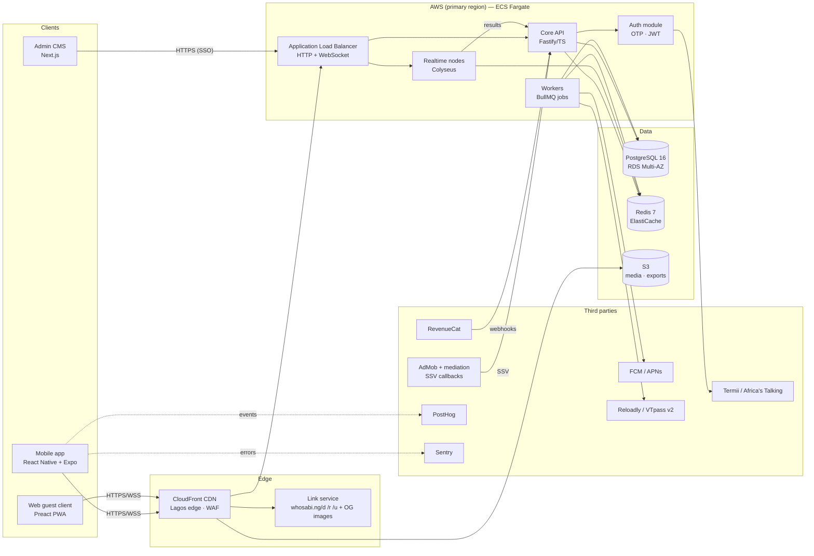
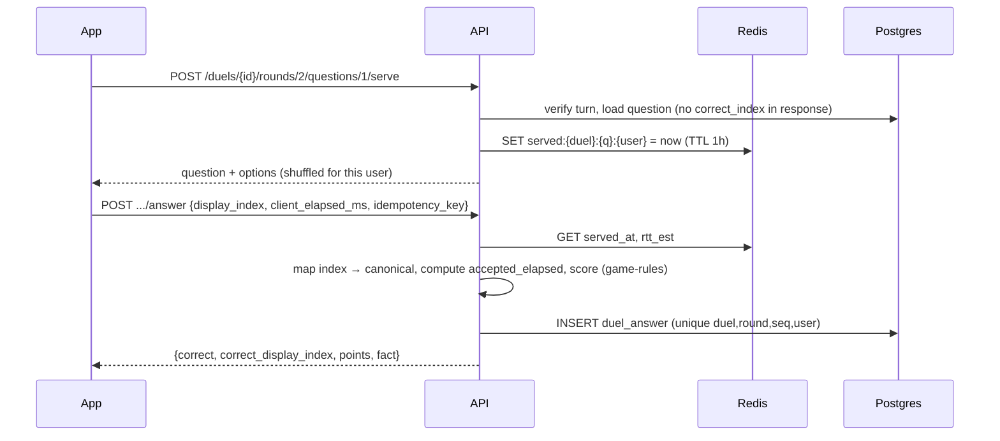
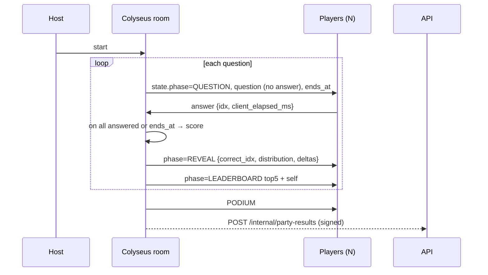

# 07 · System Architecture

**Version:** 1.0 · **Date:** 14 Oct 2026

---

## 1. High-level diagram



## 2. Components

| Component | Responsibility | Scaling unit | State |
|---|---|---|---|
| **Core API** | Auth, profiles, friends, content serving, duels, daily, economy/ledger, shop, leagues, reports, webhooks, admin endpoints | Stateless containers, auto-scale on CPU/RPS | None (Postgres/Redis) |
| **Realtime (Colyseus)** | Party rooms: lobby, clock, broadcast, scoring, reconnection | Process per vCPU. Rooms pinned to a process; Redis presence/driver for matchmaking across nodes | In-memory room state, with a snapshot to Redis every question for crash recovery |
| **Workers** | Push fan-out, turn expiry, Daily generation, difficulty recalibration, re-scoring, leaderboard snapshots, DSAR exports, OG image rendering | Queue-depth auto-scaling | None |
| **Link service** | Serves deep-link landing pages with OG tags (WhatsApp preview), Android `assetlinks.json`, iOS `apple-app-site-association`, install redirect with referrer | CloudFront Functions + small Lambda | None |
| **Admin CMS** | Content workflow, LiveOps, moderation, support | Single small service | None |

### Why a modular monolith for the API
For a team of 3–6 engineers, one deployable API with clear internal modules (auth, content, duel, party-results, daily, economy, social, admin) is faster to build and operate than microservices. Module boundaries are enforced with lint rules (no cross-module DB access). Only the realtime service is separate, because its scaling and connection profile are different.

## 3. Repository layout (monorepo, pnpm + Turborepo)
```
who-sabi/
├── apps/
│   ├── mobile/          # Expo app
│   ├── web-guest/       # Preact party client
│   ├── cms/             # Next.js admin
│   ├── api/             # Fastify modular monolith
│   ├── realtime/        # Colyseus server
│   └── workers/         # BullMQ processors
├── packages/
│   ├── shared-types/    # Zod schemas → TS types + OpenAPI
│   ├── game-rules/      # scoring, timing clamp, shuffling, Glicko-2 (pure, 100% tested)
│   ├── i18n/            # EN / Pidgin strings (ICU)
│   ├── ui/              # RN design system
│   └── config/          # eslint, tsconfig
├── infra/terraform/     # VPC, ECS, RDS, ElastiCache, S3, CloudFront, WAF
├── content/             # seed CSVs, import scripts
└── .github/workflows/   # CI/CD
```
`packages/game-rules` is shared by the API, realtime and client (for display only). There is one source of truth for scoring.

## 4. Key runtime flows

### 4.1 Duel answer


### 4.2 Party question cycle


## 5. Deployment topology

| Item | MVP sizing | Notes |
|---|---|---|
| Region | One primary region chosen from **Lagos-RTT probes during beta**. Default **eu-west-2 (London)**: mature services and usually good subsea routes to Lagos *(inferred, measure it)*. Alternative: af-south-1 (Cape Town) | CloudFront Lagos edge for static/media |
| API | 2–6 × Fargate tasks (1 vCPU / 2 GB) | Min 2 for HA |
| Realtime | 2–4 × Fargate tasks (2 vCPU / 4 GB), ~2,500 concurrent connections per vCPU target | ALB with WebSocket support; direct per-node routing through the Colyseus `publicAddress` |
| Workers | 1–4 × Fargate tasks (0.5 vCPU / 1 GB) | Scale on queue depth |
| Postgres | RDS db.t4g.large Multi-AZ, 100 GB gp3 → db.r7g.large later | PITR 7 days; read replica for analytics exports |
| Redis | ElastiCache cache.t4g.medium with replica → r7g later | Separate logical DBs: cache, queues, presence |
| CDN/WAF | CloudFront + AWS WAF managed rules + rate rules | Bot control on OTP endpoints |

### Monthly infrastructure cost estimate (MVP, about 20k DAU) *(inferred, AWS on-demand list prices, excluding tax)*
| Item | US$ / month |
|---|---|
| Fargate (API 2 + RT 2 + workers 1, average) | 180–260 |
| RDS Multi-AZ t4g.large + storage | 150–200 |
| ElastiCache t4g.medium ×2 | 70–90 |
| ALB + NAT + data transfer | 80–150 |
| CloudFront + S3 | 20–60 |
| Sentry, PostHog (free/low tiers), RevenueCat (free under revenue threshold) | 0–80 |
| SMS OTP (~30k OTP a month × ₦10) | ~₦300k (~US$225) |
| **Total** | **≈ US$750–1,050 / month** (≈ ₦1.0–1.4M) |

A leaner option for pre-seed: a single region on Render/Railway/Fly with managed Postgres (Neon/Supabase) and Upstash Redis, at roughly US$150–300 a month until there's product-market fit. The architecture is the same, only the hosting differs.

## 6. Resilience
- **Realtime node crash:** the room state snapshot in Redis (after each question) lets a new node rehydrate the room. Clients auto-reconnect using the room ID plus a session token. Target: under 10 s disruption.
- **API dependency failures:** circuit breakers (SMS, RevenueCat). Push sends are retried by the queue with exponential backoff.
- **DB:** Multi-AZ failover under 2 min. Writes are idempotent so clients can retry safely.
- **Graceful degradation order:** ads → images → leaderboards → party → duels → login. Duels and login are protected the longest.
- **Kill switches** via feature flags: ads, shop, Question Factory, party rooms, each separately.

## 7. Security architecture (summary; see doc 10)
- WAF in front of everything. Rate limits per IP, device and user (Redis token bucket).
- JWT (ES256) short-lived access tokens. Refresh tokens are rotated and stored hashed; reuse is detected.
- Internal service calls (realtime → API) use mTLS or HMAC-signed requests.
- Least-privilege IAM. RDS in private subnets. No public DB endpoints.
- The admin CMS sits behind SSO (Google Workspace) with role-based access, IP allow-list and an audit trail.

## 8. Observability
- **Logs:** pino JSON → CloudWatch → (optional) Grafana Loki.
- **Metrics:** Prometheus/OpenTelemetry to Grafana Cloud. Dashboards: API RED, WS connections, room count, questions/s, OTP success rate by network, push delivery, ad fill, ledger balance drift.
- **Tracing:** OpenTelemetry auto-instrumentation for Fastify, pg and ioredis.
- **Alerts:** p95 latency > 500 ms for 5 min, 5xx > 1%, OTP success < 85%, WS disconnect spikes, queue lag > 2 min, ledger imbalance ≠ 0.
- **Synthetic probes:** k6/Checkly from a Lagos vantage point (a device farm or a small VPS in a Lagos DC) every 5 min.
