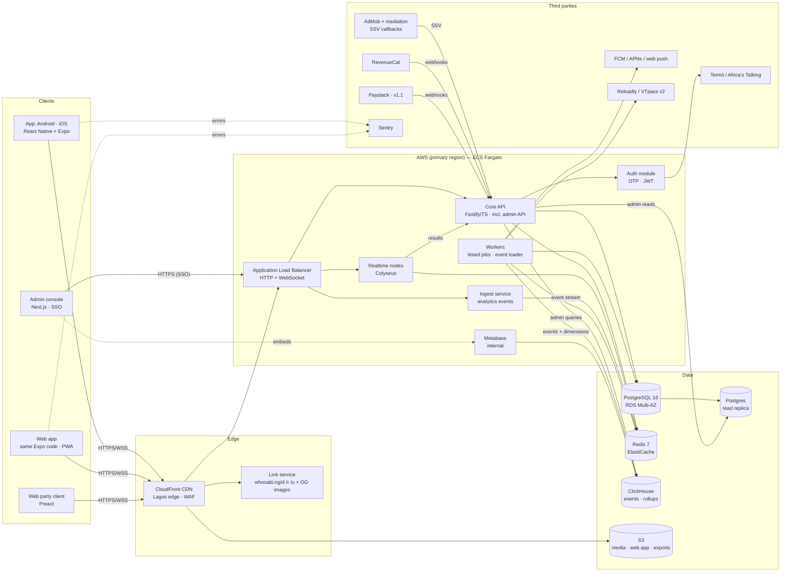
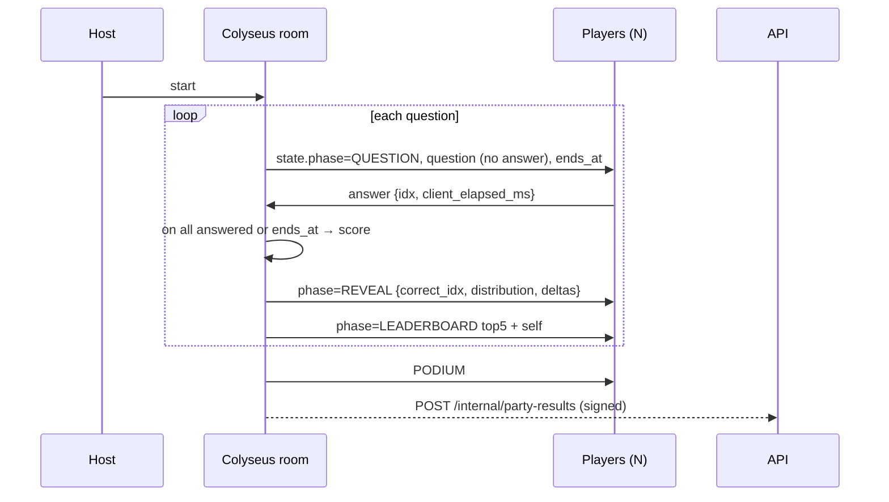
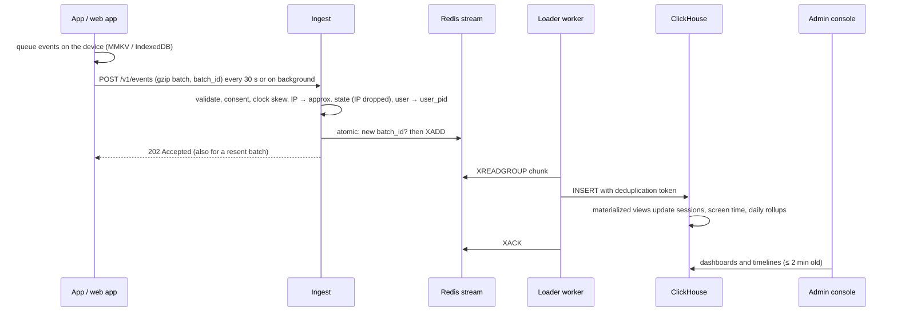

# 07 · System Architecture

**Version:** 1.1 · **Date:** 15 Oct 2026 · *1.1 adds the web app, the admin console and the analytics pipeline*

---

## 1. High-level diagram



## 2. Components

| Component | Responsibility | Scaling unit | State |
|---|---|---|---|
| **Core API** | Auth, profiles, friends, content serving, duels, daily, economy/ledger, shop, leagues, reports, webhooks, and the admin API (permissions, audit, queries for the console) | Stateless containers, auto-scale on CPU/RPS | None (Postgres/Redis) |
| **Web app** | The Expo app's web build: static files plus a service worker | CloudFront (no servers) | Browser storage only |
| **Realtime (Colyseus)** | Party rooms: lobby, clock, broadcast, scoring, reconnection | Process per vCPU. Rooms pinned to a process; Redis presence/driver for matchmaking across nodes | In-memory room state, with a snapshot to Redis every question for crash recovery |
| **Workers** | Push fan-out, turn expiry, Daily generation, difficulty recalibration, re-scoring, leaderboard snapshots, DSAR exports, OG image rendering, the event loader (Redis stream → ClickHouse), dimension sync (read replica → ClickHouse), integrity scoring, KPI alerts | Queue-depth auto-scaling | None |
| **Ingest service** | Receives event batches from the apps, checks them against the tracking plan, enforces consent, pseudonymises, appends to the Redis stream (doc 18 §15) | Stateless containers, auto-scale on requests per second | None (Redis stream) |
| **Analytics store (ClickHouse)** | Raw events, sessions, time per screen and per-person daily rollups behind the admin console | One node at MVP, scale up then out | Events 13 months, rollups 25 months |
| **Link service** | Serves OG tags for link previews (WhatsApp), Android `assetlinks.json`, iOS `apple-app-site-association`, install redirect with referrer; sends people without the app to the web app (or the party client for `/r/` links) | CloudFront Functions + small Lambda | None |
| **Admin console** | Players and User 360, live monitor, analytics, content workflow, LiveOps, moderation, support, compliance (doc 18), with Metabase embedded for exploration | One small service plus a Metabase container | None |

### Why a modular monolith for the API
For a team of 3–6 engineers, one deployable API with clear internal modules (auth, content, duel, party-results, daily, economy, social, admin) is faster to build and operate than microservices. Module boundaries are enforced with lint rules (no cross-module DB access). Only two services are separate: realtime, because its scaling and connection profile are different, and ingest, because its high write volume must never slow gameplay.

## 3. Repository layout (monorepo, pnpm + Turborepo)
```
who-sabi/
├── apps/
│   ├── app/             # Expo app: Android, iOS and the web app (Expo Router)
│   ├── web-guest/       # Preact party client for light /r/{CODE} links
│   ├── admin/           # Next.js admin console (doc 18)
│   ├── api/             # Fastify modular monolith, incl. the admin API
│   ├── realtime/        # Colyseus server
│   ├── ingest/          # analytics event intake
│   └── workers/         # timed jobs + event loader (for now apps/api/src/worker.ts, sharing the API's code)
├── packages/
│   ├── shared-types/    # Zod schemas → TS types + OpenAPI
│   ├── game-rules/      # scoring, timing clamp, shuffling, Glicko-2 (pure, 100% tested)
│   ├── analytics/       # tracking plan + client and server SDK
│   ├── flags/           # flag and experiment evaluation (server), typed flag keys (clients)
│   ├── i18n/            # EN / Pidgin strings (ICU)
│   ├── ui/              # RN design system (renders on the web through react-native-web)
│   └── config/          # eslint, tsconfig
├── infra/terraform/     # VPC, ECS, RDS, ElastiCache, ClickHouse, S3, CloudFront, WAF
├── content/             # seed CSVs, import scripts
└── .github/workflows/   # CI/CD
```
`packages/game-rules` is shared by the API, realtime and client (for display only). There is one source of truth for scoring.

## 4. Key runtime flows

### 4.1 Duel answer
```mermaid
sequenceDiagram
  participant C as App
  participant A as API
  participant R as Redis
  participant P as Postgres
  C->>A: POST /duels/{id}/rounds/2/questions/1/serve
  A->>P: verify turn, load question (no correct_index in response)
  A->>P: INSERT duel_answers (served_at = now) ON CONFLICT DO NOTHING
  A-->>C: question + options (shuffled for this user)
  C->>A: POST .../answer {display_index, client_elapsed_ms} + Idempotency-Key
  A->>P: lock the duel; read served_at
  A->>R: GET rtt:{session} (build step 1.2; a configured default until then)
  A->>A: map index → canonical, compute accepted_elapsed, score (game-rules)
  A->>P: UPDATE duel_answers (first answer wins); next turn if the turn is done; COMMIT
  A->>R: after the commit: HINCRBY qstat:{q}, XADD ev:stream
  A-->>C: {correct, correct_display_index, points, fact, next}
```

### 4.2 Party question cycle


### 4.3 Event tracking (feeds the admin console)

Server events (answers, matches, coins, purchases) skip the HTTP step: the API, realtime and workers write them straight to the stream.

## 5. Deployment topology

| Item | MVP sizing | Notes |
|---|---|---|
| Region | One primary region chosen from **Lagos-RTT probes during beta**. Default **eu-west-2 (London)**: mature services and usually good subsea routes to Lagos *(inferred, measure it)*. Alternative: af-south-1 (Cape Town) | CloudFront Lagos edge for static/media |
| API | 2–6 × Fargate tasks (1 vCPU / 2 GB) | Min 2 for HA |
| Realtime | 2–4 × Fargate tasks (2 vCPU / 4 GB), ~2,500 concurrent connections per vCPU target | ALB with WebSocket support; direct per-node routing through the Colyseus `publicAddress` |
| Workers | 1–4 × Fargate tasks (0.5 vCPU / 1 GB) | Scale on queue depth |
| Ingest | 1–4 × Fargate tasks (0.5 vCPU / 1 GB) | Scale on requests per second |
| Web app | S3 + CloudFront (static) | Each release in a versioned folder; rollback = point CloudFront at the previous one |
| Admin console + Metabase | 1 × Fargate task each (0.5 vCPU / 1 GB; Metabase 1 vCPU / 2 GB) | Behind the ALB and SSO; never exposed to players |
| Postgres | RDS db.t4g.large Multi-AZ, 100 GB gp3 → db.r7g.large later | PITR 7 days; a db.t4g.medium read replica serves the admin console and dimension sync |
| ClickHouse | ClickHouse Cloud entry tier, or 1 × EC2 r7g.large with gp3 storage *(inferred)* | Same region as the API; daily backups |
| Redis | ElastiCache cache.t4g.medium with replica → r7g later | Separate logical DBs: cache, queues, presence |
| CDN/WAF | CloudFront + AWS WAF managed rules + rate rules | Bot control on OTP endpoints |

### Monthly infrastructure cost estimate (MVP, about 20k DAU) *(inferred, AWS on-demand list prices, excluding tax)*
| Item | US$ / month |
|---|---|
| Fargate (API 2 + RT 2 + workers 1 + ingest 1 + admin 1 + Metabase 1, average) | 240–340 |
| RDS Multi-AZ t4g.large + storage, plus a t4g.medium read replica | 220–300 |
| ElastiCache t4g.medium ×2 | 70–90 |
| ALB + NAT + data transfer | 80–150 |
| CloudFront + S3 (media and the web app) | 30–80 |
| ClickHouse (Cloud entry tier or one EC2 node) | 60–200 |
| Sentry, RevenueCat (free under revenue threshold), Firebase (free/low tiers) | 0–60 |
| SMS OTP (~30k OTP a month × ₦10) | ~₦300k (~US$225) |
| **Total** | **≈ US$925–1,445 / month** (≈ ₦1.2–1.9M) |

A leaner option for pre-seed: a single region on Render/Railway/Fly with managed Postgres (Neon/Supabase), Upstash Redis and the smallest ClickHouse Cloud tier (or one small ClickHouse VM), at roughly US$200–400 a month until there's product-market fit. The architecture is the same, only the hosting differs.

**Chosen for launch (28 Oct 2026):** this leaner path, on Heroku in the Europe region (Heroku Postgres and Key-Value Store), with analytics events kept in Postgres until ClickHouse is needed. See build plan steps 1.3 and 1.6.

## 6. Resilience
- **Realtime node crash:** the room state snapshot in Redis (after each question) lets a new node rehydrate the room. Clients auto-reconnect using the room ID plus a session token. Target: under 10 s disruption.
- **API dependency failures:** circuit breakers (SMS, RevenueCat). Push sends are retried by the queue with exponential backoff.
- **DB:** Multi-AZ failover under 2 min. Writes are idempotent so clients can retry safely.
- **Analytics outage:** ingest or ClickHouse being down never touches gameplay. The apps keep events for up to 7 days, the Redis stream buffers several hours (up to a length cap that protects Redis memory), and the loader catches up; the console shows a "data delayed" banner.
- **Graceful degradation order:** analytics → ads → images → leaderboards → party → duels → login. Duels and login are protected the longest.
- **Kill switches** via feature flags: ads, shop, Question Factory, party rooms, web purchases, web ads, each separately.
- **Web app releases:** each release is a new versioned folder, so rollback is instant. The service worker checks for an update at launch and switches at the next navigation, never mid-match.

## 7. Security architecture (summary; see doc 10)
- WAF in front of everything. Rate limits per IP, device and user (Redis token bucket).
- JWT (ES256) short-lived access tokens. Refresh tokens are rotated and stored hashed; reuse is detected.
- Internal service calls (realtime → API) use mTLS or HMAC-signed requests.
- Least-privilege IAM. RDS in private subnets. No public DB endpoints.
- The admin console sits behind Google Workspace SSO with enforced 2-step verification, role-based access checked by the admin API, an optional IP allow-list, PII masking and an audit trail of every view and action (doc 18 §16).
- The web app uses a strict Content Security Policy and an HttpOnly refresh cookie, and loads no third-party scripts except Google sign-in and, from v1.1, Paystack and Google's web ads.

## 8. Observability
- **Logs:** pino JSON → CloudWatch → (optional) Grafana Loki.
- **Metrics:** Prometheus/OpenTelemetry to Grafana Cloud. Dashboards: API RED, WS connections, room count, questions/s, OTP success rate by network, push delivery, ad fill, ledger balance drift, events/s and ingest lag. Product and business metrics live in the admin console (doc 18).
- **Tracing:** OpenTelemetry auto-instrumentation for Fastify, pg and ioredis.
- **Alerts:** p95 latency > 500 ms for 5 min, 5xx > 1%, OTP success < 85%, WS disconnect spikes, queue lag > 2 min, ingest lag > 2 min, quarantined events > 1%, ledger imbalance ≠ 0.
- **Synthetic probes:** k6/Checkly from a Lagos vantage point (a device farm or a small VPS in a Lagos DC) every 5 min.
