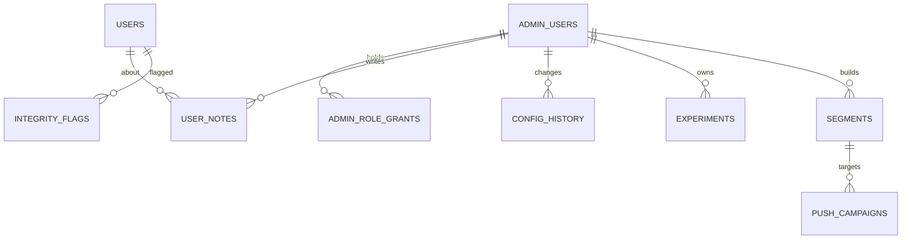

# 08 · Data Model

**Version:** 1.1 · **Date:** 15 Oct 2026
**DDL:** [`schema/schema.sql`](schema/schema.sql). It was validated on PostgreSQL 16, and the 104 seed questions load cleanly through [`content/csv_to_sql.py`](content/csv_to_sql.py).
**Analytics store:** [`schema/analytics.clickhouse.sql`](schema/analytics.clickhouse.sql) (ClickHouse, §6). It was validated with sample events, and its example queries return the expected results.

---

## 1. Entity-relationship overview

```mermaid
erDiagram
  USERS ||--o{ AUTH_IDENTITIES : has
  USERS ||--o{ DEVICES : uses
  USERS ||--o{ CONSENT_RECORDS : gives
  USERS ||--o{ FRIENDSHIPS : "a/b"
  USERS ||--o{ RATINGS : "overall + per category"
  USERS ||--o{ DUELS : "player_a / player_b"
  DUELS ||--|{ DUEL_ROUNDS : contains
  DUELS ||--o{ DUEL_ANSWERS : records
  QUESTIONS ||--o{ DUEL_ANSWERS : answered
  CATEGORIES ||--o{ QUESTIONS : groups
  QUESTIONS ||--|| QUESTION_STATS : aggregates
  QUESTIONS ||--o{ QUESTION_REPORTS : flagged
  PACKS ||--o{ PACK_QUESTIONS : includes
  QUESTIONS ||--o{ PACK_QUESTIONS : in
  MEDIA_ASSETS ||--o{ QUESTIONS : illustrates
  DAILY_CHALLENGES ||--o{ DAILY_RESULTS : played
  USERS ||--o{ DAILY_RESULTS : plays
  USERS ||--|| STREAKS : keeps
  PARTY_GAMES ||--o{ PARTY_RESULTS : ranks
  LEAGUES ||--o{ LEAGUE_MEMBERS : has
  LEAGUES ||--o{ LEAGUE_WEEK_SCORES : scores
  LEDGER_TRANSACTIONS ||--|{ LEDGER_ENTRIES : balances
  LEDGER_ACCOUNTS ||--o{ LEDGER_ENTRIES : posts
  USERS ||--o{ LEDGER_ACCOUNTS : owns
  USERS ||--o{ ENTITLEMENTS : holds
  USERS ||--o{ PURCHASES : makes
  USERS ||--o{ USER_INVENTORY : owns
  COSMETICS ||--o{ USER_INVENTORY : item
  SPONSORS ||--o{ PRIZE_EVENTS : funds
  PRIZE_EVENTS ||--o{ PRIZE_CLAIMS : awards
```

Admin console tables ([doc 18](18-admin-console-and-analytics.md)):

## 2. Entity notes

| Entity | Key design choices |
|---|---|
| `users` | One row for guests and registered users. `status` drives restrictions. `age_band` is set at signup, and `13_17` forces `restricted` behaviour in the app layer. `home_state` uses 2-letter Nigerian state codes for state leaderboards. `signup_platform`, `last_platform`, `last_seen_at` and `acquisition_source` feed the admin console; `last_seen_at` is written at most every 5 minutes per user |
| `auth_identities` | Several login methods per user. `phone_hash` (SHA-256 of E.164) is indexed on its 3-byte prefix for k-anonymity contact discovery (TRD FR-SOC-2) |
| `questions` | Options stored as a JSONB array in canonical order, plus `correct_index`. Shuffling happens at serve time. `d_rating` is the calibrated difficulty. `version` increments on edit, and answers record the question at play time (via `question_id` plus nightly re-score jobs) |
| `question_stats` | Write-heavy counters. Increment in Redis (`HINCRBY`) and flush to Postgres every minute to avoid row-lock contention on hot questions |
| `user_question_seen` | The fallback for no-repeat. The primary store is a Redis bloom filter per user (`seen:{user}`, about 1% false positives, 30-day rolling via two rotating filters). Partition monthly by `seen_at` and drop partitions older than 60 days |
| `duels` / `duel_rounds` / `duel_answers` | Answers keep every raw timing field for anti-cheat, plus the `platform` and, on the web, `tab_hidden_ms`. The PK `(duel, round, seq, user)` makes answer submission idempotent |
| `party_games` / `party_results` | Only results are persisted, not per-answer rows (high volume, low value). Per-answer data goes to analytics events |
| `daily_*` | `daily_results` PK prevents replays. `grid` stores the emoji pattern for re-sharing |
| Ledger | Double entry: every `ledger_transaction` has at least two `ledger_entries` that sum to 0 per currency. User accounts can't go negative (CHECK). A nightly job recomputes balances from entries and alerts on any drift |
| `ad_rewards` | The PK `reward_ref` is the AdMob SSV `transaction_id` or, for web ads (v1.1), the server-issued ad session id, so duplicate callbacks are ignored |
| `purchases` / `entitlements` | `store` is `play`, `app_store` or `paystack` (web, v1.1). Entitlements from every source land in one table, so a pass bought anywhere works everywhere |
| `prize_events` | `purchase_independent` has a CHECK that it is TRUE, so a non-compliant event can't be created. `rules_url` is mandatory and `states_excluded` supports per-state legal carve-outs |
| `consent_records` | An append-only consent history (NDPA accountability) |
| `dsar_requests` | Tracks the 30-day statutory clock |
| `admin_users` / `admin_role_grants` | Staff identities from Google Workspace SSO (no passwords). Privileged roles need a second approver, and a CHECK stops anyone approving their own grant. `expires_at` time-boxes contractors |
| `admin_audit_log` | Every admin action **and every view of a player**. Append-only (the app role can only INSERT and SELECT). `reason` is required for PII reveals, exports and grants |
| `user_notes` | Internal notes on a player for support and moderation; never shown to the player |
| `integrity_flags` | Anti-cheat and abuse signals with a 0–1 risk score and evidence, waiting for a human decision |
| `feature_flags` / `experiments` / `config_history` | In-house flags and A/B tests (replacing PostHog flags). Every config change is kept, so any value can be rolled back |
| `segments` / `push_campaigns` / `alert_rules` | Saved player segments (compiled to ClickHouse SQL), push campaigns to them (v1.1, four-eyes approval) and KPI alerts |

## 3. Redis keyspace

| Key | Type | TTL | Purpose |
|---|---|---|---|
| `otp:{e164}` | hash {code_hash, attempts} | 5 min | OTP verification |
| `rl:{scope}:{id}` | string/counter | window | Rate limiting (token bucket) |
| `served:{match}:{qid}:{user}` | string (ms timestamp) | 1 h | Timing anchor |
| `rtt:{session}` | list (last 5) | 1 h | RTT estimate |
| `seen:{user}:{a|b}` | Bloom filter (RedisBloom) | 30 d rotating | No-repeat questions |
| `mm:{bucket}` | sorted set (enqueue time) | – | Random matchmaking queue |
| `lb:daily:{yyyymmdd}` | sorted set | 8 d | Daily percentile/leaderboard |
| `lb:daily:{yyyymmdd}:state:{st}` | sorted set | 8 d | State board |
| `lb:league:{id}:{isoweek}` | sorted set | 21 d | League week |
| `qstat:{qid}` | hash | flushed every minute | Hot counters |
| `room:{roomId}:snap` | string (msgpack) | 30 min | Party room crash recovery |
| `code:{CODE}` | string → roomId | room life + 10 min | Room code reservation |
| `bull:*` | BullMQ | – | Job queues |
| `cfg:*` | hash | 60 s | Cached remote config, flags and experiments |
| `presence:{platform}` | sorted set (user id → last seen, ms) | trimmed to 10 min | "Online now" in the admin console |
| `live:{metric}:{yyyymmdd}` | counter / HyperLogLog | 3 d | Today's tiles on the admin Overview (e.g. `live:dau:*` is a HyperLogLog of user ids) |
| `ev:stream` | stream | trimmed to ~24 h | Analytics events waiting for the loader |
| `ev:batch:{batch_id}` | string | 48 h | Accept each client event batch once |
| `adsess:{id}` | hash | 1 h | Web rewarded-ad session (v1.1) |

## 4. Data lifecycle & retention

| Data | Retention | Basis |
|---|---|---|
| Account profile | Until deletion request + 30 days processing | Contract |
| Phone number | Account lifetime | Contract (login) |
| Duel answers (raw timing) | 180 days, then aggregated | Legitimate interest (anti-cheat, fairness) |
| Party results | 2 years | Contract (history) |
| Daily results | 2 years | Contract |
| Analytics events (ClickHouse, raw) | 13 months | Consent / legitimate interest (LIA) |
| Per-person analytics rollups (sessions, screen time, daily counters) | 25 months | Legitimate interest (LIA) |
| Integrity flags | 2 years | Legitimate interest (fair play) |
| Internal notes on a player | Account lifetime | Legitimate interest (support) |
| Consent records | Account lifetime + 6 years | Legal obligation (accountability) |
| Admin audit log | 6 years | Legal obligation |
| Question reports | 2 years | Legitimate interest |
| Prize claims (v2) | 6 years | Legal and tax |
| Backups | 35 days (RDS PITR 7 days + snapshots) | – |

**Account deletion:** set `users.status='deleted'` and clear `username`, `display_name`, `avatar_id` and `home_state`. Delete `auth_identities`, `devices` and `refresh_tokens`. Keep duel and party rows with the user reference intact but display them as "Deleted player". Delete the player's rows in ClickHouse (events and rollups, including any merged guest ids) and their internal notes, and delete push tokens. The admin audit log keeps the user ID for accountability, but no profile data.

## 5. Sizing estimate (12 months, 250k MAU / 80k DAU) *(inferred)*
| Table | Rows | Size |
|---|---|---|
| users | 1.5M | ~0.6 GB |
| questions | 15k | ~20 MB |
| duel_answers | 80k DAU × 10 answers × 365 ≈ 290M → aggregated after 180 days ≈ 145M live | ~25 GB (partition by month) |
| daily_results | 40k × 365 ≈ 15M | ~2 GB |
| ledger_entries | ~8 per DAU per day ≈ 230M | ~25 GB (partition by month) |
| analytics.events (ClickHouse) | 80k DAU × ~120 events × 365 ≈ 3.5B | ~200–250 GB compressed |

So `duel_answers` and `ledger_entries` should be **declaratively partitioned by month** from day one in production (the DDL shows unpartitioned tables for clarity).

## 6. Analytics store (ClickHouse)

Behavioural and business events live in ClickHouse, not Postgres, so a year of events stays fast to query and never loads the game database. Full DDL and example queries: [`schema/analytics.clickhouse.sql`](schema/analytics.clickhouse.sql). How the data gets there: [doc 18 §15](18-admin-console-and-analytics.md).

| Table | What it holds | Kept |
|---|---|---|
| `events` | Every client and server event, with platform, device, network and approximate state. Partitioned by month and ordered by event, WAT date and user | 13 months |
| `session_days` | One row per session per WAT day: first and last event, foreground time, screens | 25 months |
| `screen_days` | Time and views per screen per person per day (time by mode = time by screen area) | 25 months |
| `user_days` | Per-person daily counters: time, answers, matches, coins, ad and purchase revenue | 25 months |
| `person_days` (view) | `user_days` with merged guest IDs counted as their account. Every KPI is built on it | – |
| `users_dim`, `questions_dim` | Attributes synced from the read replica every 5 minutes, without PII | Current |
| `user_aliases` | Guest ID → account links after a merge | Account lifetime |
| `events_quarantine` | Events that failed validation | 30 days |

- **Pseudonymous.** Players appear as `user_pid` (HMAC-SHA256 of the user ID, key in Secrets Manager). No phone numbers, emails, names, free text or IP addresses are stored.
- **Counted once.** Ingest accepts each client batch once, and the loader inserts with a deduplication token, so a retry never changes a count or a time total (rollups included).
- **Tested.** With sample events covering a session across midnight WAT, a web guest merged into an Android account and a retried load, the example queries (DAU, minutes per DAU, sessions, timeline, funnel, retention, time by mode, busiest hours) return the expected numbers.
