# 08 · Data Model

**Version:** 1.0 · **Date:** 14 Oct 2026
**DDL:** [`schema/schema.sql`](schema/schema.sql). It was validated on PostgreSQL 16, and the 104 seed questions load cleanly through [`content/csv_to_sql.py`](content/csv_to_sql.py).

---

## 1. Entity-relationship overview

```mermaid
erDiagram
  USERS ||--o{ AUTH_IDENTITIES : has
  USERS ||--o{ DEVICES : uses
  USERS ||--o{ CONSENT_RECORDS : gives
  USERS ||--o{ FRIENDSHIPS : "a/b"
  USERS ||--o{ RATINGS : "overall + per category"
  USERS ||--o{ DUELS : "player_a / player_b"
  DUELS ||--|{ DUEL_ROUNDS : contains
  DUELS ||--o{ DUEL_ANSWERS : records
  QUESTIONS ||--o{ DUEL_ANSWERS : answered
  CATEGORIES ||--o{ QUESTIONS : groups
  QUESTIONS ||--|| QUESTION_STATS : aggregates
  QUESTIONS ||--o{ QUESTION_REPORTS : flagged
  PACKS ||--o{ PACK_QUESTIONS : includes
  QUESTIONS ||--o{ PACK_QUESTIONS : in
  MEDIA_ASSETS ||--o{ QUESTIONS : illustrates
  DAILY_CHALLENGES ||--o{ DAILY_RESULTS : played
  USERS ||--o{ DAILY_RESULTS : plays
  USERS ||--|| STREAKS : keeps
  PARTY_GAMES ||--o{ PARTY_RESULTS : ranks
  LEAGUES ||--o{ LEAGUE_MEMBERS : has
  LEAGUES ||--o{ LEAGUE_WEEK_SCORES : scores
  LEDGER_TRANSACTIONS ||--|{ LEDGER_ENTRIES : balances
  LEDGER_ACCOUNTS ||--o{ LEDGER_ENTRIES : posts
  USERS ||--o{ LEDGER_ACCOUNTS : owns
  USERS ||--o{ ENTITLEMENTS : holds
  USERS ||--o{ PURCHASES : makes
  USERS ||--o{ USER_INVENTORY : owns
  COSMETICS ||--o{ USER_INVENTORY : item
  SPONSORS ||--o{ PRIZE_EVENTS : funds
  PRIZE_EVENTS ||--o{ PRIZE_CLAIMS : awards
```

## 2. Entity notes

| Entity | Key design choices |
|---|---|
| `users` | One row for guests and registered users. `status` drives restrictions. `age_band` is set at signup, and `13_17` forces `restricted` behaviour in the app layer. `home_state` uses 2-letter Nigerian state codes for state leaderboards |
| `auth_identities` | Several login methods per user. `phone_hash` (SHA-256 of E.164) is indexed on its 3-byte prefix for k-anonymity contact discovery (TRD FR-SOC-2) |
| `questions` | Options stored as a JSONB array in canonical order, plus `correct_index`. Shuffling happens at serve time. `d_rating` is the calibrated difficulty. `version` increments on edit, and answers record the question at play time (via `question_id` plus nightly re-score jobs) |
| `question_stats` | Write-heavy counters. Increment in Redis (`HINCRBY`) and flush to Postgres every minute to avoid row-lock contention on hot questions |
| `user_question_seen` | The fallback for no-repeat. The primary store is a Redis bloom filter per user (`seen:{user}`, about 1% false positives, 30-day rolling via two rotating filters). Partition monthly by `seen_at` and drop partitions older than 60 days |
| `duels` / `duel_rounds` / `duel_answers` | Answers keep every raw timing field for anti-cheat. The PK `(duel, round, seq, user)` makes answer submission idempotent |
| `party_games` / `party_results` | Only results are persisted, not per-answer rows (high volume, low value). Per-answer data goes to analytics events |
| `daily_*` | `daily_results` PK prevents replays. `grid` stores the emoji pattern for re-sharing |
| Ledger | Double entry: every `ledger_transaction` has at least two `ledger_entries` that sum to 0 per currency. User accounts can't go negative (CHECK). A nightly job recomputes balances from entries and alerts on any drift |
| `ad_rewards` | The AdMob SSV `transaction_id` is the PK, so duplicate callbacks are ignored |
| `prize_events` | `purchase_independent` has a CHECK that it is TRUE, so a non-compliant event can't be created. `rules_url` is mandatory and `states_excluded` supports per-state legal carve-outs |
| `consent_records` | An append-only consent history (NDPA accountability) |
| `dsar_requests` | Tracks the 30-day statutory clock |

## 3. Redis keyspace

| Key | Type | TTL | Purpose |
|---|---|---|---|
| `otp:{e164}` | hash {code_hash, attempts} | 5 min | OTP verification |
| `rl:{scope}:{id}` | string/counter | window | Rate limiting (token bucket) |
| `served:{match}:{qid}:{user}` | string (ms timestamp) | 1 h | Timing anchor |
| `rtt:{session}` | list (last 5) | 1 h | RTT estimate |
| `seen:{user}:{a|b}` | Bloom filter (RedisBloom) | 30 d rotating | No-repeat questions |
| `mm:{bucket}` | sorted set (enqueue time) | – | Random matchmaking queue |
| `lb:daily:{yyyymmdd}` | sorted set | 8 d | Daily percentile/leaderboard |
| `lb:daily:{yyyymmdd}:state:{st}` | sorted set | 8 d | State board |
| `lb:league:{id}:{isoweek}` | sorted set | 21 d | League week |
| `qstat:{qid}` | hash | flushed every minute | Hot counters |
| `room:{roomId}:snap` | string (msgpack) | 30 min | Party room crash recovery |
| `code:{CODE}` | string → roomId | room life + 10 min | Room code reservation |
| `bull:*` | BullMQ | – | Job queues |
| `cfg:*` | hash | 60 s | Cached remote config |

## 4. Data lifecycle & retention

| Data | Retention | Basis |
|---|---|---|
| Account profile | Until deletion request + 30 days processing | Contract |
| Phone number | Account lifetime | Contract (login) |
| Duel answers (raw timing) | 180 days, then aggregated | Legitimate interest (anti-cheat, fairness) |
| Party results | 2 years | Contract (history) |
| Daily results | 2 years | Contract |
| Analytics events (PostHog) | 13 months | Consent / legitimate interest |
| Consent records | Account lifetime + 6 years | Legal obligation (accountability) |
| Admin audit log | 6 years | Legal obligation |
| Question reports | 2 years | Legitimate interest |
| Prize claims (v2) | 6 years | Legal and tax |
| Backups | 35 days (RDS PITR 7 days + snapshots) | – |

**Account deletion:** set `users.status='deleted'` and clear `username`, `display_name`, `avatar_id` and `home_state`. Delete `auth_identities`, `devices` and `refresh_tokens`. Keep duel and party rows with the user reference intact but display them as "Deleted player". Purge PostHog through its API and delete push tokens.

## 5. Sizing estimate (12 months, 250k MAU / 80k DAU) *(inferred)*
| Table | Rows | Size |
|---|---|---|
| users | 1.5M | ~0.6 GB |
| questions | 15k | ~20 MB |
| duel_answers | 80k DAU × 10 answers × 365 ≈ 290M → aggregated after 180 days ≈ 145M live | ~25 GB (partition by month) |
| daily_results | 40k × 365 ≈ 15M | ~2 GB |
| ledger_entries | ~8 per DAU per day ≈ 230M | ~25 GB (partition by month) |

So `duel_answers` and `ledger_entries` should be **declaratively partitioned by month** from day one in production (the DDL shows unpartitioned tables for clarity).
