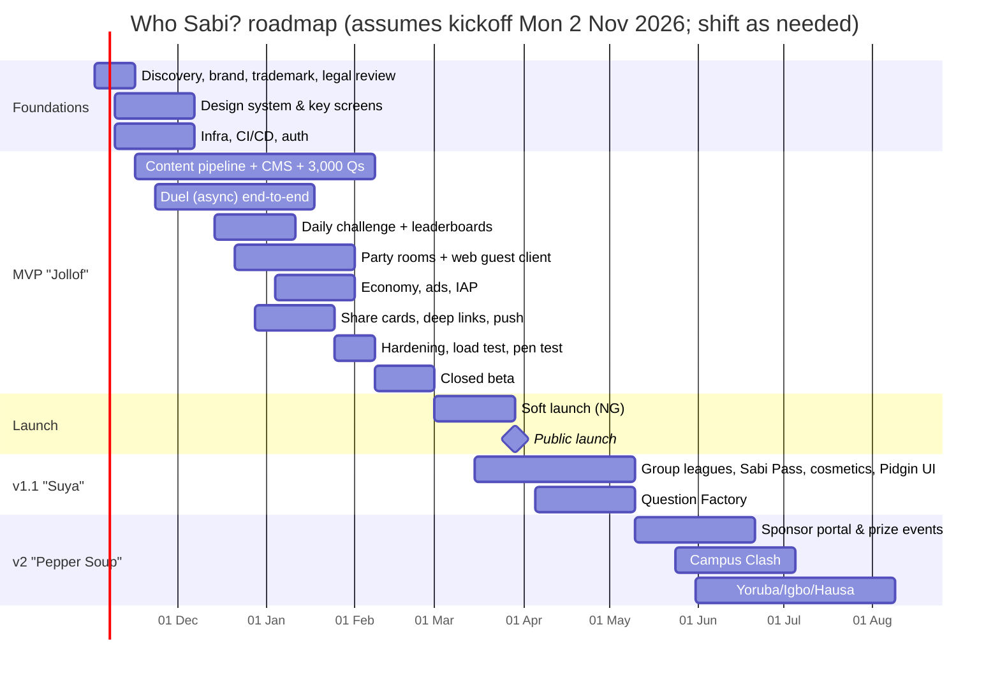

# 15 · Roadmap, Team & Delivery Plan

**Version:** 1.0 · **Date:** 14 Oct 2026

---

## 1. Release roadmap

| Milestone | Week | Definition of done |
|---|---|---|
| M0 Kickoff | 0 | Team in place, docs signed off |
| M1 "First duel" | 8 | Two internal users complete a duel on real devices against staging |
| M2 Feature complete | 12 | All P0 stories done, 2,000+ approved questions |
| M3 Beta | 14 | Closed track live, 500+ testers |
| M4 Soft launch | 17 | Public Play listing in Nigeria, iOS on TestFlight/App Store |
| M5 Public launch | 21 at the earliest; timed to the next cultural moment (doc 12 §4) | Marketing push, sponsor pack live |
| M6 v1.1 | 27 | Leagues and Sabi Pass live |
| M7 v2 | ~40 | Sponsor portal, Campus Clash season 1, local languages |

## 2. MVP sprint plan (2-week sprints)

| Sprint | Engineering | Design | Content |
|---|---|---|---|
| S0 (W0–1) | Monorepo, Terraform base, CI, Expo skeleton, auth (guest + OTP) | Brand, design tokens, FTUE and question screen | Hire writers, style guide, CMS spec |
| S1 (W2–3) | Content service + CMS v0 (CRUD, CSV import), question serving, game-rules package | Home, duel flow, results | 500 Qs |
| S2 (W4–5) | Duel state machine, serve/answer, timing clamp, push (your turn) | Party lobby and in-game | 1,000 Qs |
| S3 (W6–7) | Duel complete (rounds, tiebreak, expiry, random matchmaking + bot), friends | Daily, share cards | 1,600 Qs |
| S4 (W8–9) | Daily + leaderboards, Colyseus party room v1, deep links + link service | Shop, profile, settings | 2,200 Qs |
| S5 (W10–11) | Web guest client, ledger + coins, lifelines, AdMob + SSV, RevenueCat | Polish, motion, accessibility | 2,800 Qs |
| S6 (W12–13) | Data Saver, analytics events, Sentry, account deletion/DSAR, anti-cheat signals, load and pen test fixes | Store assets | 3,000+ Qs, calibration from internal play |
| Beta (W14–16) | Bug fixes, economy tuning, performance on low-end devices | Iterate from feedback | Weekly refresh begins |

## 3. Team

### MVP core team (lean)
| Role | FTE | Responsibilities |
|---|---|---|
| Product lead / founder | 1 | Vision, priorities, sponsor sales (early), legal coordination |
| Tech lead (full-stack, backend-leaning) | 1 | Architecture, API, realtime, infra |
| Mobile engineer (React Native) | 1 | App, performance on low-end devices, store releases |
| Full-stack engineer | 1 | CMS, web guest client, link service, analytics |
| Product designer (UI/UX + illustration direction) | 1 | Design system, flows, share cards, store assets |
| Content lead / editor | 1 | Question pipeline, writers, LiveOps calendar, community |
| Freelance writers | 5–8 part-time | Questions |
| Illustrator (contract) | 0.5 | Avatars, cosmetics, pack covers |
| QA (contract, from S4) | 0.5–1 | Device lab, Maestro flows, field tests |
| DPO (outsourced) | – | NDPA compliance |

### Added for v1.1–v2
Partnerships / sponsorship sales lead, community manager, second backend engineer, data analyst (part-time).

## 4. Budget to public launch (≈ 5 months, *inferred*, Lagos market rates)

| Item | ₦ |
|---|---|
| Salaries (5 FTE × ~5 months; blended ~₦1.5M a month) | 37,500,000 |
| Freelance writers (3,000 Qs × ₦450) + editor overhead | 2,000,000 |
| Illustration and audio | 2,500,000 |
| Infrastructure (dev + staging + prod ramp) | 3,000,000 |
| Tools (Expo EAS, Sentry, Figma, Google Workspace, etc.) | 1,500,000 |
| Legal (company, trademark, privacy, gaming/promo opinion), DPO, pen test | 6,000,000 |
| Device lab (10 devices) + SIMs/data | 2,500,000 |
| Pre-launch and launch marketing (doc 12) | 19,000,000 |
| Contingency (10%) | 7,400,000 |
| **Total** | **≈ ₦81M (~US$61k)** |

A leaner "founder + 2 engineers + freelance designer" version takes about 6–7 months and costs roughly ₦40–45M.

## 5. Dependencies & critical path
1. **Content volume** (3,000 approved Qs) is the critical path. Start writers in week 2, not after the app is built.
2. Legal opinions on prize events and NDPA work must be finished before beta.
3. Google Play developer account (organisation, D-U-N-S number) and AdMob approval can take 2–4 weeks, so start in week 0.
4. Termii sender ID registration and NCC approval: start in week 0.
5. Music audio licensing (v1.1) has a long lead time; start conversations at launch.

## 6. Definition of Done (per story)
- Acceptance criteria met and demoed on a low-end device.
- Unit and integration tests written and passing in CI.
- Analytics events implemented per the taxonomy.
- Strings externalised (i18n), accessibility labels added.
- Feature flag in place for risky features.
- Docs/runbooks updated if needed.
