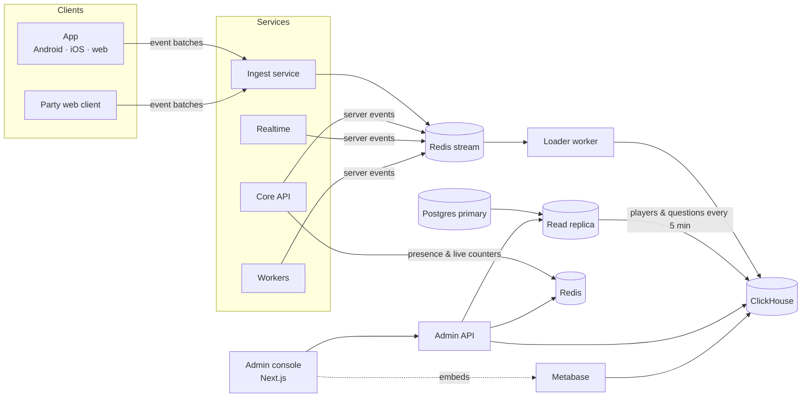

# 18 · Admin Console & Analytics Platform

**Version:** 1.0 · **Date:** 15 Oct 2026
**Related:** [06 TRD](06-TRD.md) · [07 Architecture](07-system-architecture.md) · [08 Data Model](08-data-model.md) · [10 Security & Compliance](10-security-anti-cheat-privacy-compliance.md) · [13 Analytics](13-analytics-and-metrics.md)
**Schemas:** [`schema/schema.sql`](schema/schema.sql) (admin tables) · [`schema/analytics.clickhouse.sql`](schema/analytics.clickhouse.sql) (events, sessions, time spent)

---

## 1. Purpose & principles

The admin console is the one place the team uses to see and run everything in *Who Sabi?*: who is playing right now, what each player does and for how long, how the game, content and money are performing, and what staff have done. It replaces the plan in v1.0 of this pack, which split this across PostHog dashboards and a content-only CMS.

1. **One console, everything in it.** Players, live activity, analytics, content, LiveOps, moderation, support, money and compliance. Nobody should need database access to answer a question about the game.
2. **Every player action is recorded, with time.** Sessions, screens, answers, matches, purchases, ads and notifications, on Android, iOS and web (§2).
3. **The numbers match the truth.** Answers, matches, coins and purchases are recorded by the server, not the phone, so dashboards agree with the database and with finance.
4. **Private by default.** Analysts work with pseudonymous IDs. Phone numbers and emails stay masked until someone with permission reveals them for a stated reason, and every look at a player's data is logged (§16).
5. **See it, act on it.** Anything you can see, you can act on from the same screen, within your role's limits (§8).
6. **Works on a phone too.** The Overview and Live pages are usable on a phone, so the founder and the on-call engineer can check in from anywhere.

## 2. What gets tracked (and what never does)

### 2.1 Tracked
| Area | What we record | Recorded by |
|---|---|---|
| Sessions & time | Every session start, every move to the background and back, time on each screen, total time per day, platform, app version, device model, network type, carrier, approximate state | App and web clients |
| Navigation | Every screen viewed and how long it stayed on screen; the taps that matter (play, share, invite, buy, report) | Clients |
| Gameplay | Every question served and answered (choice, right or wrong, time taken, lifeline), every round, duel, party game, Daily and practice pack, including abandons and forfeits | Server |
| Social | Friend requests, invites shared (and on which channel), invite links opened, rooms joined, share cards made | Clients and server |
| Economy | Every coin and gem movement and its reason; lifelines used; cosmetics bought and equipped | Server (ledger) |
| Money | Store and web purchases, refunds, subscriptions (start, renew, cancel); ads requested, shown and rewarded; estimated ad revenue per impression | Server and ad SDK |
| Messaging | Pushes sent, delivered (where the platform reports it) and opened | Server and clients |
| Quality | Crashes and errors (Sentry), network drops and reconnects, slow screens, web vitals | Clients |
| Safety | Reports filed, moderation actions, integrity signals (accuracy outliers, timing anomalies, switching tabs during a web question) | Server |
| Settings & consent | Language, Data Saver, notifications, family mode, every consent change | Server |

Every event carries its platform (Android, iOS or web), so every number in the console can be split by platform. The full event list is the tracking plan in [doc 13 §2](13-analytics-and-metrics.md).

### 2.2 Never tracked
- Anything outside our app: other apps, browsing history, the clipboard.
- Keystrokes or drafts. We record that a username was set, not what was typed on the way.
- Precise location. We keep the player's chosen home state and an approximate state worked out from the IP address at ingest; the IP itself is then dropped. Nigerian mobile IPs often map to the wrong state, so the console labels IP-based states "approx." and prefers the chosen one.
- Contacts. Contact discovery sends 20-bit hash prefixes only, and nothing is stored (TRD FR-SOC-2).
- Microphone, camera or photos.
- Card details. The stores and Paystack handle payment; we only receive the result.
- Screen recordings at launch. Optional session replay (v1.1, §11) needs a DPIA first.

Players aged 13–17 are tracked for the service and for safety only. They are never put in marketing segments, push campaigns, price experiments or session replay.

### 2.3 Consent *(counsel to confirm)*
- **Core usage** (sessions, foreground time, app version, crashes) and **service events** (gameplay, purchases, security) run under contract and legitimate interest, documented in the LIA. These give complete time-spent and activity numbers for every player.
- **Detailed behaviour** (each screen, taps, time per screen, funnels) needs analytics consent: the cookie banner asks on the web, and the onboarding privacy step asks in the app. Without it, the client sends only core and service events.
- The ingest service enforces this: it drops detailed-behaviour events from players without consent. Consent changes are logged in `consent_records`.

## 3. Who uses it: roles & permissions

Staff sign in with Google Workspace SSO, with 2-step verification enforced. Roles can be combined, and anything not granted is denied.

| Role | Sees | Can do | Player PII |
|---|---|---|---|
| Owner | Everything | Everything, including granting roles | Reveal with reason |
| Admin | Everything | Config, flags, player actions, approvals | Reveal with reason |
| Analyst | All analytics, segments, Explore | Dashboards, segments, pseudonymous exports | Never |
| Growth | Overview, growth, retention, segments, campaigns | Segments, draft push campaigns, referral codes | Never |
| LiveOps | Overview, Live, LiveOps, content performance | Daily schedule, config, flags, banners, events | Never |
| Editor | Content, reports queue, content analytics | Approve, suspend and re-score questions; schedule packs | Never |
| Fact-checker / Writer | Content (writers see their own drafts) | Draft, check and comment on questions | Never |
| Moderator | User 360 (masked), reports, integrity flags | Warn, mute, rename, shadow-restrict, ban; resolve flags | Masked only |
| Support | User 360 (masked), tickets | Small coin grants, streak restores, sign-outs, start DSARs | Last 4 digits; full reveal with reason |
| Finance | Revenue, purchases, refunds, reconciliation | Financial exports, refund notes | Never |
| Sponsor manager (v2) | Sponsors, campaigns, brand reports | Sponsor packs and reports | Never |
| DPO | Compliance, audit log, consent, retention | DSARs, erasure, access reviews | Reveal with reason |
| Engineer (on-call) | Live, tech health, flags | Kill switches, close rooms, re-run jobs | Never |
| Viewer | Overview and KPI dashboards | Nothing | Never |

- Owner, Admin, Finance and DPO grants need a second approver, and nobody approves their own grant (`admin_role_grants.approved_by`).
- Built so far (step 2.7a): Overview and Live for owners, admins, analysts, growth, LiveOps, moderators, on-call engineers and viewers (`overview.view`); removing a player from a party room or closing it for owners, admins, moderators and engineers (`live.manage`).
- Built in step 2.7b: support's actions on a player (coin grants, streak restores, signing out everywhere) for owners, admins and support (`players.support`); notes for anyone who can see the player. Signing a player out from the on-call engineer's seat comes with tech health.
- Built in step 2.7c: flags, kill switches and the status banner for owners, admins, LiveOps and on-call engineers (`liveops.flags`).
- Built in step 2.7d: warnings, renames, hiding from the boards, bans and the integrity queue for owners, admins and moderators (`players.moderate`); a ban longer than 30 days, or for good, needs an admin or owner (the second-moderator approval comes later).
- Built in step 2.7f: the Daily scheduler for owners, admins and LiveOps (`liveops.daily`).
- Built in step 2.7g: the game and economy values, with history and rollback, for owners, admins and LiveOps (`liveops.config`).
- Contractor access expires on its own (`expires_at`).
- The DPO reviews every staff account and role each quarter.

## 4. Console map & phasing

```
Admin console (admin.whosabi.ng, SSO only)
├── Overview ....... live KPIs, today vs last week, alerts
├── Live ........... who's online, live party rooms, activity feed
├── Players ........ search → User 360
├── Analytics ...... Engagement & time · Growth & invites · Retention · Funnels · Paths (v1.1)
│                    Gameplay · Content · Monetisation · Economy · Platforms & tech health · Integrity
│                    Explore · Segments · Reports & alerts
├── LiveOps ........ Daily scheduler · Config · Flags & kill switches · Experiments · Banners · Events · Push campaigns (v1.1)
├── Content ........ questions, packs, media, imports, reports queue (the CMS)
├── Moderation ..... reports, usernames, integrity flags, enforcement, appeals
├── Support ........ tickets, macros, grants
├── Commerce ....... purchases, refunds, subscriptions, reconciliation; sponsors & prize events (v2)
├── Compliance ..... DSAR queue, erasure, consent, retention jobs, audit log
└── Settings ....... staff, roles, alert rules
```

| Phase | What ships |
|---|---|
| **MVP** (with the soft launch) | Overview, Live, Players and User 360 (full timeline and time spent), all Analytics dashboards except Paths, Explore, Segments (build, count, export with approval), Content, LiveOps (Daily, config, flags, kill switches, banners, events), Moderation & integrity, Support, Commerce (store purchases), Compliance, Settings, threshold alerts |
| **v1.1** | Push campaigns to segments, experiments UI with results, Paths, scheduled email reports, anomaly alerts, Paystack reconciliation, league analytics, read-only "preview as player" for support, optional session replay (after the DPIA) |
| **v2** | Sponsor portal and brand reports, prize events and airtime payouts, Campus Clash analytics |

Until the experiments UI ships, analysts read experiment results in Explore.

## 5. Overview (the home screen)

Tiles refresh every 15 seconds and charts every 2 minutes.

| Tile | Shows |
|---|---|
| Online now | Players active in the last 5 minutes, split Android / iOS / web, with a 24-hour sparkline |
| Today so far | DAU, new players (by platform and source), matches (duel turns, party games, Dailies), each against the same time last week |
| Time spent | Minutes per DAU today; median session length |
| Money today | Purchases (store and web), subscriptions started, estimated ad revenue, coins earned and spent |
| Live games | Party rooms open and players in them; duels waiting on a turn |
| Health | Crash-free sessions (24 h), API p95, OTP success by carrier (last hour), event ingest lag |
| Queues | Open reports, auto-suspended questions, open integrity flags, DSARs due within 7 days |
| Alerts | Every alert rule that is firing |

Charts: DAU over 30 days, activity by hour today against last week, top states, top categories today, and new players by source.

## 6. Live monitor

- **Online players:** everyone active in the last 5 minutes, with platform, current screen and mode, app version, network and approximate state. Filter by platform, state or mode; click through to User 360.
- **Live party rooms:** code, host, players (app and web), phase, question number, room age and server node. Moderators and on-call engineers can open a room view, kick a player or close the room.
- **Activity feed:** key events as they happen (sign-ups, duels finished, purchases, reports). PII-free, and sampled when traffic is high.
- **Now by state:** a table and map of players online per state.

"Online" comes from Redis presence sets (`presence:{platform}`) that the API, realtime and ingest services update at most once a minute per session. A player counts as online if seen in the last 5 minutes.

## 7. Players: search & User 360

### 7.1 Search
Find a player by username, user ID, phone number (exact match only, permission needed, logged), email, device ID, duel ID, party room code or support ticket number. Results show masked identifiers.

### 7.2 User 360
One page per player, in tabs:

| Tab | Contents |
|---|---|
| **Summary** | Username, avatar, status, age band, home state, signup date and platform, acquisition source, platforms used, last seen, level, tier and rating, coins and gems, Sabi Pass status, lifetime spend, friends, streak, risk score, open flags, latest notes |
| **Timeline** | Every event in order, grouped into sessions. For example: "Opened app (Android 1.2.0, MTN 4G, Lagos) → Home 12 s → Duel vs Chidi → Q1 correct in 4.2 s → … → Watched rewarded ad → +25 coins → Left the app (6 min 12 s)". Filter by event type, platform and date; jump into any match |
| **Sessions & time** | Every session with start, end, time spent, platform, app version and network; time per day (90-day chart); time by mode (duel, party, Daily, practice, shop, menus); time by platform; busiest hours; average session length |
| **Matches** | Duels with each question, both players' answers, timings and scores; party games; Dailies with their grids; practice; tie-breaks and forfeits |
| **Money** | Ledger history (every coin and gem movement and why), purchases and refunds, subscriptions, ad rewards, inventory |
| **Social** | Friends, invites sent and accepted, referrals, leagues |
| **Safety** | Reports filed and received, moderation history, integrity flags with evidence, other accounts on the same devices |
| **Devices & consent** | Devices (model, OS, app version, push on or off), sign-in methods (masked), consents with dates and policy versions |
| **Support** | Tickets, grants made, internal notes (`user_notes`) |
| **Admin history** | Every staff view of and action on this player, from the audit log |

Phone numbers and emails are masked (`+234 80• ••• 1234`). **Reveal** needs the right role and a reason, and it is logged. There is no chat in the game, so there is no message content to show.

A guest who later signs in to an existing account appears as one person, with one timeline (guest IDs are linked through `analytics.user_aliases`).

## 8. Actions, limits & approvals

| Action | Who | Limits and approval |
|---|---|---|
| Grant coins | Support, Admin | Support: up to 500 per player per day; admins and owners up to 5,000. Above 5,000 needs a second approver. Always through the ledger (`reason='admin_grant'`) |
| Restore a streak | Support | Once per player every 30 days |
| Warn, mute, rename | Moderator | Logged; the player is told |
| Shadow-restrict, ban | Moderator | A ban longer than 30 days needs a second moderator or an admin |
| Sign the player out everywhere | Support, Engineer | Logged |
| Suspend or re-score a question | Editor | Re-scoring runs as a job; affected players are told |
| Change remote config | LiveOps, Admin | Shown as a diff with a reason; one-click rollback (`config_history`) |
| Flip a kill switch | LiveOps, Engineer, Admin | Instant; announced in the alerts channel |
| Push campaign (v1.1) | Growth drafts it | An admin approves audiences over 10,000 players; quiet hours and frequency caps always apply |
| Export data | Analyst (pseudonymous), Finance (financial) | Reason required; files are watermarked with the requester's name; download links expire in 24 hours. Only the DPO exports personal data (DSAR) |
| Erase an account / DSAR | DPO (Support can start one) | 30-day clock tracked; erasure covers Postgres and ClickHouse |
| Grant a role | Owner | Privileged roles need a second approver |

Every action is written to `admin_audit_log` with its before and after values. Nobody can edit a match result, score or leaderboard by hand; corrections go through the re-score job.

## 9. Analytics dashboards

Every dashboard shares the same filters: date range, platform (Android / iOS / web), app version, state, acquisition source, age band, new or returning, and segment. Each chart can be exported (§8) or opened in Explore with the same query.

| Dashboard | What it shows |
|---|---|
| **Engagement & time** | DAU, WAU, MAU, stickiness (DAU/MAU), sessions per DAU, minutes per DAU, session-length distribution, time by mode and by screen, busiest hours (WAT heatmap), Daily completion rate |
| **Growth & invites** | New players by source and platform; the invite funnel (shared → opened → played → signed up → installed); K-factor by channel; web-to-account and web-to-app conversion; creator and ambassador code leaderboard |
| **Retention** | D1, D7 and D30 cohort tables by signup week, platform and source; retention curves; returning lapsed players; churn-risk list (v1.1) |
| **Funnels** | Ready-made funnels (first-time flow, duel invite, party join, purchase) and a funnel builder over any events within a time window |
| **Paths (v1.1)** | Most common screen paths, where players drop off, what players do after a loss |
| **Gameplay** | Matches by mode, completion and abandon rates, duel turn response time, forfeit rate, party sizes and share of web guests, Daily score distribution, category popularity, lifeline use |
| **Content performance** | Per question: plays, correct %, average answer time, option distribution, report rate and `d_rating` drift; the same by category and pack; questions flagged as too easy or too hard |
| **Monetisation** | Revenue by stream (ads, store purchases, Paystack, Sabi Pass, sponsorship), ARPDAU, ARPPU, payer conversion, LTV by cohort, ad fill, eCPM, rewarded views per DAU, subscriptions (MRR and churn), refunds |
| **Economy** | Coin sources and sinks, inflation index, balance distribution, lifeline and cosmetic spend, starter pack take-up |
| **Platforms & tech health** | Crash-free sessions by platform and device, ANRs, cold start by RAM bucket, web vitals, API latency, OTP success by carrier and provider, push delivery, reconnect rate, data used per match |
| **Integrity** | Accuracy z-score outliers, timing anomalies, tab-switch signals, multi-account clusters, actions taken, appeals |

**Explore.** For anything the dashboards don't cover, analysts use Metabase (open source, self-hosted) inside the console. It connects only to pseudonymous ClickHouse views, as a read-only user with query timeouts and row limits.

**Segments.** Build a group of players from any mix of properties and behaviour ("5+ duels in the last 7 days, home state Lagos, plays on web, never purchased"), see its size and trend, save it, and use it as a dashboard filter, an experiment audience or (v1.1) a push campaign audience.

**Reports & alerts.** Threshold alerts ship with the MVP and go to email and Slack, for example "OTP success below 85% for 15 minutes" or "DAU down 20% against the same hour last week". Scheduled email reports (a daily pulse at 08:00 WAT and a weekly KPI pack on Mondays) and anomaly alerts come in v1.1.

## 10. Metric definitions

Each metric has one definition, used by every dashboard, export and alert. All days are WAT days.

| Metric id | Definition |
|---|---|
| `dau` / `wau` / `mau` | People with at least one session on the day, or in the last 7 or 30 days. Guest IDs merged into an account count as that account |
| `new_players` | People whose first-ever session falls on that day |
| `session` | A run of activity with no gap longer than 30 minutes |
| `time_spent` | Foreground time: the app on screen, or the web tab visible. If a session's last report is lost (crash, app killed), its span is used instead |
| `minutes_per_dau` | Total time spent ÷ DAU |
| `dn_retention` | Share of a day's new players who are active again exactly *n* days later (D1, D7, D30) |
| `d7_retention` | `dn_retention` with *n* = 7 (the default guardrail) |
| `wsm` | Weekly Social Matches, the north star: completed matches with at least two humans who know each other (doc 13) |
| `match_completed` | A duel finished (forfeits included), a party game that reached the podium, or a completed Daily |
| `k_factor` | Invites sent per new player × invite acceptance rate |
| `arpdau` | Net revenue ÷ DAU over the period. Ad revenue is an estimate until AdMob's final figures (T+2 days) |
| `payer_conversion` | Share of MAU with at least one purchase in the period |
| `crash_free_sessions` | Sessions without a crash ÷ all sessions (from Sentry) |
| `reports_per_1k` | Question reports per 1,000 answers |

## 11. LiveOps & experiments

| Tool | What it does |
|---|---|
| Daily scheduler | Calendar of the next 30 Dailies; swap questions until 22:00 WAT the day before; preview exactly what players will see |
| Remote config | Every game and economy value (GDD §10) with its current value, history, diff and one-click rollback; changes can target a platform, an app version or a segment |
| Flags & kill switches | On/off and percentage rollouts by platform and version; kill switches for ads, shop, party rooms, Question Factory and web purchases |
| Experiments | Variants and weights, audience, primary metric and guardrails. Assignment hashes the experiment key with the user ID, so a player always sees the same variant on every device; exposures are logged as events. Results with confidence intervals arrive in the v1.1 UI |
| Banners & status | Home banners and the in-app status banner ("Party rooms are having issues. Duels still work") |
| Events | Flash packs, Weekend Wahala and Live Party Nights (doc 16) with start and end times |
| Push campaigns (v1.1) | Segment → message (English and Pidgin) → schedule → approval → send; results show delivered, opened and played within 24 hours |

**Session replay (v1.1, optional).** Only if the DPIA supports it: record about 2% of web sessions from consenting adults (rrweb, self-hosted), with every text field masked, kept for 30 days and viewable only by the product and support leads. Native replay only if a vendor passes the same review.

## 12. Content, moderation & integrity

- **Content** is the CMS from [doc 04](04-content-strategy-and-question-bible.md) and TRD §4.9, inside the console: question workflow, CSV import, media, packs, the name dictionary, duplicate detection, calibration and the reports queue. Each question shows its live performance from §9.
- **Moderation** covers the reports queue, username and nickname review, the enforcement ladder ([doc 10 §2](10-security-anti-cheat-privacy-compliance.md)) and appeals.
- **Integrity** lists the flags from the nightly job (`integrity_flags`) by risk score, each with its evidence: accuracy against question difficulty, timing, time with the tab hidden on the web, and linked devices. A moderator dismisses or acts on each one. Nothing bans a player automatically.

## 13. Support, commerce & sponsors

- **Support:** tickets from the helpdesk (Freshdesk, Zendesk or Crisp) show on User 360, alongside the macros in doc 16 §3 and grants within the §8 limits.
- **Commerce:** every purchase (Play, App Store, Paystack), refund and chargeback, and every subscription, with a daily reconciliation against RevenueCat and Paystack. Mismatches raise an alert.
- **Sponsors (v2):** sponsor accounts and campaigns, plus a brand report (reach, questions answered, time in the pack, shares, recall accuracy) shared as a PDF or through a read-only sponsor login. Brand reports only ever show aggregates.

## 14. Compliance & privacy controls

- **DSAR queue** with the 30-day clock, an export builder (everything we hold about one player, from Postgres and ClickHouse) and erasure that also deletes the player's events and rollups in ClickHouse.
- **Consent dashboard:** consent rates by purpose and platform.
- **Retention jobs:** the status of each one (raw events 13 months, rollups 25 months, raw duel timing 180 days; doc 08 §4).
- **Audit log search:** who looked at or changed what, when, and why.
- **Access review:** the quarterly list of staff and roles for the DPO to confirm.

## 15. Data architecture & freshness



- **Client SDK** (`packages/analytics`, the same code on Android, iOS and web): typed events from the tracking plan, queued on the device (MMKV in the app, IndexedDB on the web), sent in gzipped batches every 30 seconds, at 20 events, and whenever the app goes to the background (on the web, with `sendBeacon` on `pagehide`). In Data Saver mode it sends every 2 minutes. Offline, it keeps events for up to 7 days. Typical cost: under 30 KB of data a day.
- **Ingest service** (`apps/ingest`): checks each event against the tracking plan (unknown events and suspected PII go to quarantine), drops detailed-behaviour events without consent, corrects device clock skew, works out the approximate state from the IP and discards the IP, swaps the user ID for its `user_pid`, and appends the batch to a Redis stream. A resent batch (same `batch_id`) is acknowledged and dropped, so nothing is counted twice. Ingest never blocks gameplay: if it is down, the apps keep their queues.
- **Server events** (answers, matches, coins, purchases, pushes) are written to the same stream by the API, realtime and workers, through the same package.
- **Loader worker:** reads the stream and inserts into ClickHouse every 5 seconds or 10,000 rows, with a deduplication token so a retried insert is never counted twice. If ClickHouse is unavailable the stream keeps buffering, up to a length cap that protects Redis memory (several hours at launch volumes); the ingest-lag alert fires long before the cap is reached.
- **Stores:** ClickHouse holds events, per-day sessions, time per screen and per-person daily rollups ([`schema/analytics.clickhouse.sql`](schema/analytics.clickhouse.sql)). Operational data (ledger, purchases, duels) is read from the **Postgres read replica**, never the primary. Live numbers come from **Redis**.

| Data | Fresh within |
|---|---|
| Online now, live rooms, today's counters | 15 s |
| Event dashboards, timelines, funnels, purchases | 2 min |
| Player and question attributes | 5 min |
| Ad revenue | Estimate in 2 min; AdMob's figures at T+1, final at T+2 |
| Store and Paystack settlements | Daily reconciliation |

## 16. Admin security

- The console is a separate app at `admin.whosabi.ng`, not reachable from the player apps, and is never indexed by search engines.
- **Staff tools on a phone** (owner's decision, 28 Oct 2026; build plan step 2.9): owners and admins also get a Staff tab in the player app, with live numbers, player lookup and staff alerts. A phone signs in with the staff Google account for 30 days, the tab opens only with the phone's fingerprint or PIN, the session ends at once when the person loses the role or is suspended, and every staff phone is listed in the console (**Staff phones**) where it can be signed out. Revealing PII, exports and role changes stay in the console.
- Google Workspace SSO with 2-step verification enforced; security keys for Owner, Admin, Finance and DPO. Sessions expire after 12 hours.
- You sign in again before revealing PII, exporting, granting coins above the limit, changing roles or publishing config to production.
- An optional IP allow-list (office or VPN) for Owner, Admin and Finance.
- The admin API checks permissions on the server for every request; the interface only hides what you can't use.
- Every view of a player and every action goes into the append-only `admin_audit_log`.
- PII is masked by default; analysts and Metabase see pseudonymous data only.
- Exports are watermarked, logged and expire after 24 hours.
- No shared accounts. Leavers lose access the same day through SSO.
- Quarterly access review by the DPO; the yearly penetration test includes the console.

## 17. Non-functional requirements

| Area | Requirement |
|---|---|
| Speed | Overview and User 360 load in ≤ 2 s at p75; analytics queries ≤ 3 s at p95 for 30-day ranges and ≤ 10 s for 13-month ranges |
| Freshness | As in §15 |
| Availability | 99.5% monthly. A console outage never affects players |
| Scale | Ingest sustains 5,000 events a second with p95 acceptance ≤ 100 ms at MVP, and scales by adding tasks |
| Accuracy | Matches and sign-ups reconcile with Postgres within ±1%; revenue reconciles with finance reports within ±2% |
| Browsers | Desktop Chrome, Edge, Firefox and Safari; Overview and Live usable on a phone |
| Time zone | WAT everywhere, with UTC on hover |
| Accessibility | Keyboard navigable, contrast ≥ 4.5:1, a table view for every chart |

## 18. Acceptance criteria (MVP)

- **AD-1:** A support agent can find a player by username and see a duel they just finished in their timeline within 2 minutes, with each answer, its time and the coins earned.
- **AD-2:** Daily time spent on User 360 is within ±5% of the foreground time the device reported, including sessions that cross midnight WAT.
- **AD-3:** A guest who plays on the web and then signs in to an existing account shows as one person: one timeline, counted once in DAU.
- **AD-4:** "Online now" changes within 15 seconds of a player opening or leaving the app.
- **AD-5:** Support can't see a full phone number without **Reveal**, which asks for a reason and creates an audit entry the DPO can find.
- **AD-6:** DAU, new players and matches on the Overview are within ±1% of a direct database count for the same WAT day.
- **AD-7:** A kill switch takes effect for every client within 60 seconds and appears in the audit log.
- **AD-8:** Erasing a player removes or anonymises their data in Postgres (doc 08 §4) and deletes their ClickHouse rows within the 30-day DSAR window.
- **AD-9:** A retried event upload never changes a count or a time total.
